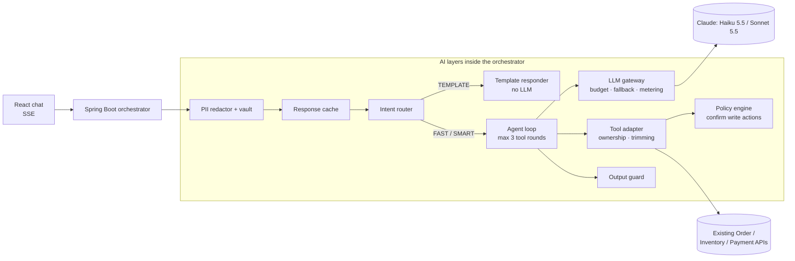

# Commerce AI Assistant

A production-style AI customer assistant built on top of existing Order, Inventory and Payment APIs. It shows how to add an LLM to a legacy commerce stack while keeping **p95 latency, LLM cost and PII exposure** under explicit control.

**Stack:** Java 17 · Spring Boot 3 · Anthropic Java SDK (Claude API or Amazon Bedrock) · Node.js mock APIs · React + TypeScript · k6 · GitHub Actions · AWS (target)

## Architecture



A request flows through:

1. **PII redactor**: emails, phones, cards, SSN and PAN become placeholders like `<EMAIL_1>`. Real values stay in a session vault, so the model never sees them.
2. **Response cache**: repeat questions are answered without an LLM call.
3. **Intent router**: picks one of three routes.
   - `TEMPLATE`: an API call plus a template, no LLM
   - `FAST`: Haiku, for lookups and FAQs
   - `SMART`: Sonnet, for write actions and complaints
4. **LLM gateway**: enforces the monthly budget, downgrades to the fast model at 90% of it, adds the refusal fallback, and meters cost.
5. **Agent loop**: makes parallel tool calls against the legacy APIs. The user's identity comes from auth, never from the model.
6. **Policy engine**: `cancel_order` only *proposes* a cancellation. The order changes only when the user presses Confirm, and the call uses an idempotency key.
7. **Output guard**: masks any PII the model produced on its own, then restores placeholders for the session owner only.

## Run it locally

Prerequisites: Java 17, Maven, Node 20+.

```bash
# 1. Mock legacy APIs (port 4000)
cd mock-apis && npm install && npm start

# 2. Orchestrator (port 8080). Without a key, only the TEMPLATE route works.
export ANTHROPIC_API_KEY=sk-ant-...
cd orchestrator && mvn spring-boot:run

# 3. Chat UI (port 5173, proxies /api to 8080)
cd web && npm install && npm run dev
```

Or run the backend with Docker: `docker compose up --build` (reads `ANTHROPIC_API_KEY` from your shell). That also starts Postgres with pgvector and turns on RAG.

**With RAG (knowledge-base search) in the step-by-step setup:** start the database, then run the orchestrator with `RAG_ENABLED=true`:

```bash
docker compose up -d postgres          # pgvector on host port 54329
RAG_ENABLED=true mvn spring-boot:run   # in orchestrator/; Flyway creates the schema, chunks are embedded at startup
```

**Demo users:** `u-1001` (Asha, 4 orders) and `u-1002` (Daniel, 1 order). Switch between them in the UI to see ownership checks: Daniel can't see Asha's orders.

### Configuration

| Variable | Default | Purpose |
|---|---|---|
| `LLM_PROVIDER` | `anthropic` | `anthropic` (Claude API) or `bedrock` (Amazon Bedrock, uses the AWS credential chain) |
| `FAST_MODEL` / `SMART_MODEL` | `claude-haiku-5-5` / `claude-sonnet-5-5` | On Bedrock use `anthropic.claude-haiku-5-5` / `anthropic.claude-sonnet-5-5` |
| `LLM_BUDGET_USD` | `3000` | Monthly cap; SMART downgrades to FAST at 90% |
| `LLM_FALLBACKS` | `true` | Server-side refusal fallback on Sonnet (Claude API only). Set to `false` if your account rejects it. |
| `LLM_WARMUP` | `true` | One tiny Haiku request at startup (about $0.0004) so the first user isn't served cold. `/actuator/health/readiness` stays 503 until it finishes. |
| `MOCK_API_URL` | `http://localhost:4000` | Base URL of the legacy APIs |
| `DEBUG_ENDPOINTS` | `true` | Exposes `/api/debug/llm-inputs` (PII eval) and `/api/debug/kb-search` (retrieval eval). Set to `false` outside dev. |
| `RAG_ENABLED` | `false` | `true`: hybrid search over Postgres + pgvector with a local embedding model. `false`: in-memory keyword search, no database (the AWS demo). |
| `DB_URL` / `DB_USER` / `DB_PASSWORD` | `jdbc:postgresql://localhost:54329/store` / `store` / `store` | Knowledge-base database; only used when `RAG_ENABLED=true` |
| `RAG_KEYWORD_WEIGHT` | `1.0` | Weight of full-text ranks in rank fusion (vector ranks weigh 1.0) |

## Prove it: evals, PII and load

```bash
node evals/run-evals.mjs            # golden set: pass rate, p50/p95, cost, PII leaks → evals/results/latest.json
node evals/run-retrieval-evals.mjs  # RAG only: keyword vs vector vs hybrid recall@1/@3, MRR (no LLM, free)
k6 run -e NO_CACHE=1 loadtest/chat.js  # 6 req/s design peak, then 15 req/s; latency per route actually taken
curl localhost:8080/api/metrics     # live spend, p95, routes, cache hits, PII counters
```

The eval run fails if the pass rate drops below 90% or **any** raw PII value appears in the text sent to the LLM. CI runs the unit tests on every push; the eval job runs on demand (it spends tokens).

### Results

Golden-set run on 2026-10-29 with streaming, prefetch and startup warm-up: 17 cases, Claude API, Haiku 5.5 for FAST and Sonnet 5.5 for SMART.

| Metric | Target | Measured |
|---|---|---|
| Eval pass rate | ≥ 90% | **100%** (17/17) |
| p95 latency, template route | < 1.5 s | **93 ms** |
| p95 latency, LLM route, full answer | < 4 s | **4.8 s** ❌, set by Sonnet (write actions and complaints). Every Haiku answer was under 2.8 s. |
| Latency p50, FAST / SMART | | **1.3 s** / **3.7 s** |
| Time to first text, LLM route | | p50 **1.3 s** |
| Cost per request, FAST / SMART | | **$0.00010** / **$0.0046** |
| Cost per request, eval mix | < $0.002 | **$0.0014** |
| PII values reaching the LLM | 0 | **0** |
| Share of requests with no LLM call | ≥ 30% | **18%** in the golden set (3/17, a deliberately LLM-heavy mix). 98% in the k6 run below, which repeats 5 questions and so overstates the cache. The real figure needs production traffic. |

What each change did (LLM route only):

| | Full-answer p50 | Full-answer p95 | First text p50 |
|---|---|---|---|
| Baseline | 3.0 s | 5.0 s | n/a |
| + streaming | 2.8 s | 6.3 s | 2.6 s |
| + prefetch | **1.4 s** | 5.2 s (≤ 4.0 s once warm) | **1.3 s** |
| + startup warm-up | 1.4 s | **4.8 s** (first call 2.1 s, was 5.2 s) | 1.3 s |

Notes:

- The first LLM call after a restart is slow: 11.4 s and 5.2 s in two runs. Likely causes are JVM warm-up, opening the TLS connection and writing the prompt cache. The orchestrator now sends a warm-up request at startup (`LLM_WARMUP`) and reports ready only after it.
- Streaming alone barely helped. Answers are short (150–650 characters), so most of the wait came before the first word, in the model round that chooses a tool. Prefetching the lookups the router can predict removes that round, and that halved the median.
- On Sonnet the answer text arrives in one burst (under 60 ms from first to last text). The server-side refusal fallback is not the cause: a run with `LLM_FALLBACKS=false` showed the same burst and the same Sonnet latency (p50 3.4 s against 3.7 s), so the fallback stays on.
- With 17 cases, p95 is the single slowest answer, and runs vary widely. Across four runs the LLM-route p95 was 6.3, 5.2, 4.8 and 8.4 s. In the slowest run, two Haiku answers waited about 8 s for their first word; the requests were unchanged, so the delay was most likely on the API side. Use the k6 run (about 1,600 requests) for p95, and the golden set for correctness and cost.

### Load test (k6)

Run on 2026-10-29 on a laptop: 6 req/s for 2 minutes (design peak), then 15 req/s for 1 minute (2.5x headroom), against the local orchestrator and mock APIs.

| Route | Requests | p50 | p95 | Max |
|---|---|---|---|---|
| Template (no LLM) | 966 | 75 ms | **86 ms** | 837 ms |
| Response cache | 629 | 5 ms | **9 ms** | 53 ms |
| FAST (Haiku) | 27 | 1.24 s | **2.15 s** | 2.48 s |
| FAST, time to first text | 27 | 1.01 s | 1.55 s | 1.85 s |

1,622 requests, 0 errors, all thresholds passed. The service held 15 req/s with no rise in latency on the non-LLM paths. The mix has no SMART questions and the cache absorbed most LLM-route repeats, so the Haiku figures rest on 27 samples. `k6 run -e NO_CACHE=1 loadtest/chat.js` makes every LLM-route question reach the model.

### Retrieval (RAG)

The knowledge base is 6 markdown documents (`orchestrator/src/main/resources/knowledge/`) split into 30 chunks, one per section. `evals/retrieval.jsonl` has 24 questions with the chunk that should answer each: 9 that share words with the policy text, 14 paraphrases with no shared keywords ("I wasn't home when the courier came"), and 1 typo. Run on 2026-10-30 with all-MiniLM-L6-v2 embeddings:

| Search | recall@1 | recall@3 | MRR |
|---|---|---|---|
| Keyword only (Postgres full-text, all words must match) | 0.21 | 0.21 | 0.21 |
| Vector only (pgvector, cosine) | 0.83 | **1.00** | 0.91 |
| **Hybrid** (rank fusion of both) | **0.83** | **1.00** | **0.91** |

How the settings were chosen, and what didn't work:

- **Distance cutoff 0.85.** Correct chunks were at most 0.81 from their question; off-topic questions ("Tell me a joke", "What's the weather in Paris?") were at least 0.87 from any chunk. So off-topic questions retrieve nothing, and the tool tells Claude not to guess. A first cutoff of 0.75 dropped four valid paraphrases.
- **Keyword matching requires all words.** Matching *any* word made hybrid worse than vector alone (recall@3 0.79), because generic words like "order" or "add" pulled in unrelated chunks. With AND, hybrid equals vector here and only adds weight on strong exact matches, such as SKU codes, which this question set doesn't cover.
- **Caveat:** the cutoff and the AND choice were tuned on the same 24 questions they're scored on. A held-out question set is the next step before trusting these numbers on new content.

## Project layout

```
orchestrator/   Spring Boot service: privacy/, routing/, llm/, agent/, tools/, knowledge/, api/
mock-apis/      Express stand-ins for the existing Order, Inventory, Payment APIs
web/            React chat UI with confirmation cards and a live metrics panel
evals/          Golden set and retrieval set (JSONL) with their runners
loadtest/       k6 script
infra/aws/      Terraform (CloudFront, ALB, ECS Fargate, Bedrock) and deploy.sh
```

## Design decisions

- **Rules-first routing.** Deterministic routing is cheap, testable and explainable. Add a Haiku classifier only where the evals show the rules missing.
- **Authorization in code, not in the prompt.** Tools receive the user ID from the authenticated request, so a prompt injection can't read another customer's order.
- **The LLM proposes, code decides.** Write actions need an explicit user confirmation and an idempotency key.
- **Trimmed tool results.** Projections leave out names, addresses and card data. That keeps PII out of the model and holds requests near 2,000 tokens.
- **A stable prompt prefix.** The system prompt and tool definitions are byte-identical across requests and pods, so they're served from the prompt cache. That's why the tool schemas are built with `LinkedHashMap` and not `Map.of`.
- **Prefetch what the rules already know.** When a question names an order or SKU, or asks about my orders or a policy, the read-only lookup runs before the first model call. Its result goes in as a tool-use exchange, which saves a model round. Write tools are never prefetched.
- **Retrieval is measured, not assumed.** Keyword, vector and hybrid search run on the same question set, and the settings come from those numbers (see Results). Postgres holds both the vectors and the full-text index, so there's no separate vector database to run. Chunks are re-embedded only when their content or the embedding model changes.
- **History as plain text.** Earlier turns are kept as text only, and within a turn the message list is append-only. Both reduce tokens per request.

## Roadmap

- [x] Orchestrator: PII redaction, router, cache, LLM gateway, agent loop, policy engine, output guard
- [x] Mock legacy APIs with ownership checks, idempotent cancel, latency and failure injection
- [x] React chat with SSE, confirmation cards, live metrics
- [x] Golden-set evals with a PII leak gate, k6 script, CI
- [x] Stream the answer as it's written, through a PII-safe streaming guard
- [x] RAG: Postgres + pgvector hybrid search, local embeddings, retrieval evals (local; off on AWS)
- [ ] RAG on AWS: RDS Postgres with pgvector and Amazon Titan embeddings on Bedrock
- [ ] Presidio sidecar for names and addresses
- [ ] Redis for cache, vault and sessions; Postgres for the audit trail
- [ ] Resilience4j circuit breakers on the tool adapter
- [ ] Cognito JWT auth in place of the demo header
- [ ] OpenTelemetry tracing, CloudWatch dashboards
- [ ] Terraform for ECS Fargate + Bedrock (see `infra/aws/`)
